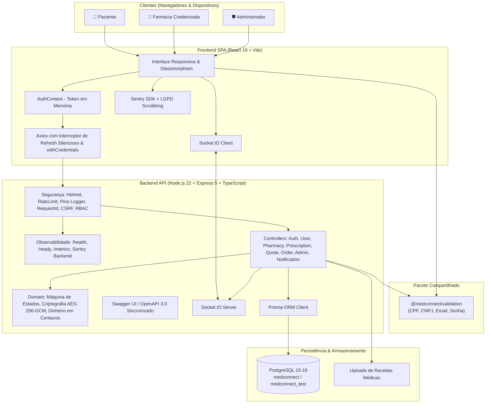

# 💊 MedConnect Application

> Plataforma completa e moderna para cotação, manipulação e acompanhamento de medicamentos entre pacientes e farmácias — desenvolvida com **Monorepo**, **TDD**, **PostgreSQL**, **Prisma**, **OpenAPI/Swagger**, **Playwright E2E**, **CI/CD com Defesa em Profundidade**, **Observabilidade/Sentry (LGPD)** e padrões rigorosos de segurança.


---

## 🚀 Destaques da Solução (Fases 1, 2 e 3)

### 1. Qualidade e Pirâmide de Testes Automatizados (> 240 testes)
- **Backend (204 testes em 22 suítes)**: Testes de integração Jest + Supertest rodando contra PostgreSQL real dedicado (`medconnect_test`).
  - **Caminho Feliz Ponta a Ponta**: Cadastro de paciente e farmácia -> upload de receita -> cotação -> aprovação transacional -> entrega.
  - **Prevenção a IDOR (OWASP API #1)**: Prova de que Paciente A não aprova cotação nem lê pedidos/receitas do Paciente B; Farmácia A não altera pedidos da Farmácia B; Farmácia não acessa dados pessoais de contato sem cotação aceita (LGPD).
  - **Concorrência Atômica**: Disparo simultâneo (`Promise.all`) de duas aprovações para a mesma cotação gerando estritamente um único pedido (`201`), rejeitando a duplicidade com `409 Conflict`.
  - **Matriz de RBAC Parametrizada**: Tabela de testes testando exaustivamente todas as rotas protegidas contra os papéis `ANONYMOUS`, `PATIENT`, `PHARMACY` e `ADMIN`.
  - **Máquina de Estados e Verificação**: Bloqueio de transições inválidas (`PENDING` -> `DELIVERED` direto) e bloqueio operacional de farmácias não verificadas pela vigilância sanitária.
  - **Limite Mínimo de Cobertura (Threshold >= 80%)**: Configurado em `backend/jest.config.js` e validado no CI (`> 83%` em Controllers e Services) — falha o build caso não seja atingido.
- **Frontend (37 testes em 6 suítes)**: React Testing Library cobrindo telas principais (Login, Cadastro de Paciente e Farmácia, Dashboard de Administração, Painel de Pedidos), máscaras de CPF/CNPJ e estados de erro/queda de API.
- **E2E com Playwright**: Fluxo ponta a ponta (`e2e/medconnect-flow.spec.ts`) executando **dois contextos de navegador isolados e simultâneos** (Paciente solicitando e aprovando; Farmácia cotando e despachando até `DELIVERED`).

### 2. Pipeline de CI/CD e Segurança (GitHub Actions)
- **Pipeline Consolidado (`.github/workflows/ci.yml`)**:
  - `lint`: ESLint frontend e backend.
  - `typecheck`: `tsc --noEmit` no backend TypeScript.
  - `test-backend`: Serviço oficial `postgres:15-alpine`, migrations via `prisma migrate deploy` e cobertura Jest (`npm run test:coverage`).
  - `test-frontend`: Testes unitários/componentes com React Testing Library.
  - `test-e2e`: Testes de navegador reais com Playwright.
  - `build`: Build do frontend Vite com injeção de `VITE_API_URL` e build do backend.
  - `security-audit`: `npm audit --omit=dev --audit-level=high`.
  - `gitleaks`: Detecção de segredos e credenciais em commits.
  - `codeql`: Análise estática profunda de vulnerabilidades (SAST).
- **Defesa em Profundidade**:
  - Todas as GitHub Actions são fixadas pelo **SHA de commit completo** (imunidade a supply-chain attacks).
  - Permissões mínimas declaradas por job (`permissions: contents: read`).
  - Runtime padronizado no Node.js 22 LTS com cache nativo.
  - **Dependabot ativo** (`.github/dependabot.yml`) monitorando npm e GitHub Actions semanalmente.
  - Workflows de deploy (`deploy-backend.yml` e `deploy-frontend.yml`) com controle de concorrência (`cancel-in-progress: false`) acionados exclusivamente após sucesso no CI.

### 3. Observabilidade e Operação
- **Healthchecks Especializados**:
  - `/health`: Liveness do processo Node.js/Express.
  - `/ready`: Readiness com verificação ativa no banco PostgreSQL (`SELECT 1` via Prisma).
- **Métricas Básicas (`/metrics`)**: Latência por rota, taxa de erro (4xx/5xx), contador de cotações pendentes e pedidos ativos.
- **Sentry com LGPD Data Scrubbing**: Integração nativa no backend e frontend ativada por variável opcional (`SENTRY_DSN` / `VITE_SENTRY_DSN`), com higienização recursiva compulsória de CPF, CNPJ, telefones, senhas, tokens e histórico médico.
- **Governança e Recuperação**:
  - Regras recomendadas de Branch Protection documentadas em `docs/operacao/branch-protection.md`.
  - Automação de backup contínuo do PostgreSQL e teste de restauração em `docs/operacao/backup-restore.md`.
  - Guia de deploy gerenciado no Render com rollback em menos de 30 segundos em `docs/operacao/deploy-render.md`.

---

## 🏛️ Arquitetura do Sistema



---

## 📁 Estrutura do Monorepo

```
MedConnect_Application/
│
├── .github/
│   ├── dependabot.yml              # Varredura semanal de dependências npm e actions
│   └── workflows/
│       ├── ci.yml                  # Pipeline CI consolidado (9 jobs com SHA fixo e Node 22)
│       ├── deploy-backend.yml      # Deploy gerenciado no Render (Staging & Produção)
│       └── deploy-frontend.yml     # Deploy contínuo do frontend no GitHub Pages
│
├── MedConnect/                     # Aplicação SPA Frontend (React 19, Vite, Tailwind/CSS)
│   ├── src/
│   │   ├── components/             # Header, BottomNav, Modais, Cards, ErrorState
│   │   ├── context/AuthContext.jsx # Autenticação em memória e renovação de sessão
│   │   ├── lib/sentry.js           # Inicialização do Sentry com LGPD Data Scrubbing
│   │   ├── pages/
│   │   │   ├── user/               # Dashboard, NewQuote, QuoteOffers, Orders, Review
│   │   │   ├── pharmacy/           # Dashboard, Requests, SendQuote, OrderManagement
│   │   │   └── admin/              # AdminDashboard (Aprovação/Rejeição com modal)
│   │   └── services/api.js         # Cliente Axios com interceptor de refresh único
│   └── package.json
│
├── backend/                        # API RESTful (Node 22, Express 5, TypeScript, Prisma)
│   ├── src/
│   │   ├── controllers/            # Controllers com validação RBAC e proteção IDOR
│   │   ├── domain/                 # Máquina de estados do pedido (orderStateMachine.ts)
│   │   ├── lib/                    # Criptografia AES-256-GCM, Sentry com data scrubbing
│   │   ├── middlewares/            # Rate limiting, metrics, requestId, errorHandler
│   │   ├── routes/                 # Rotas sincronizadas com OpenAPI (/health, /ready, /metrics)
│   │   └── docs/swagger.yaml       # Especificação OpenAPI 3.0 sincronizada e testada
│   ├── prisma/
│   │   ├── schema.prisma           # Modelagem relacional PostgreSQL, enums e índices
│   │   ├── seed.ts                 # População com dados sintéticos protegida por ambiente
│   │   └── migrations/             # Migrations versionadas em SQL
│   ├── scripts/                    # Scripts de banco (db-up.js, ensure-test-db.js)
│   ├── tests/                      # 22 suítes Jest com cobertura > 83% em controllers e services
│   └── package.json
│
├── e2e/
│   └── medconnect-flow.spec.ts     # Teste ponta a ponta Playwright com múltiplos contextos
│
├── exercicios/                     # Housekeeping: refatorar.js e testes isolados
│   ├── refatorar.js
│   └── refatorar.test.js
│
├── packages/
│   └── validation/                 # @medconnect/validation compartilhado (ESM + CJS + Types)
│
├── docs/
│   ├── operacao/                   # Manuais e runbooks de operação
│   │   ├── alerting-observability.md  # Instruções de métricas e alertas
│   │   ├── backup-restore.md          # Backup automático do Postgres e teste de restauração
│   │   ├── branch-protection.md       # Regras recomendadas para a main
│   │   └── deploy-render.md           # Deploy gerenciado no Render e rollback em 30s
│   └── decisoes/                   # Architectural Decision Records (ADRs) de 001 a 017
│
├── playwright.config.ts            # Configuração do Playwright com webServer integrado
├── docker-compose.yml              # Orquestração do serviço PostgreSQL
├── package.json                    # Raiz do Monorepo (NPM Workspaces)
└── README.md
```

---

## 📖 Decisões Arquiteturais (ADRs)

Todas as decisões técnicas do projeto estão documentadas em [`docs/decisoes/`](./docs/decisoes/):
- **[ADR 001: Adoção de Monorepo com NPM Workspaces](./docs/decisoes/001-monorepo-workspaces.md)**
- **[ADR 002: Arquitetura Backend com Node.js, TypeScript e Prisma ORM](./docs/decisoes/002-arquitetura-backend-prisma.md)**
- **[ADR 003: Validação Compartilhada com TDD e Modelo de Segurança RBAC / IDOR](./docs/decisoes/003-validacao-compartilhada-e-seguranca.md)**
- **[ADR 004: Gestão Estrita de Variáveis de Ambiente e Remoção de Fallback JWT](./docs/decisoes/004-gestao-estrita-de-variaveis-de-ambiente-e-remocao-de-fallback-jwt.md)**
- **[ADR 005: Isolamento de Banco Local, Scripts e Procedimento de Purga](./docs/decisoes/005-isolamento-de-banco-local-scripts-e-procedimento-de-purga.md)**
- **[ADR 006: Endurecimento do Docker e Isolamento de Containers](./docs/decisoes/006-endurecimento-do-docker-e-isolamento-de-containers.md)**
- **[ADR 007: Eliminação de Fallback para MockData no Frontend](./docs/decisoes/007-eliminacao-de-fallback-para-mockdata-no-frontend.md)**
- **[ADR 008: Privacidade LGPD: Anonimização de Receitas e IDOR em Pedidos](./docs/decisoes/008-privacidade-lgpd-anonimizacao-de-receitas-e-idor-em-pedidos.md)**
- **[ADR 009: Restrição Estrita de CORS e Rate Limiting Específico para Autenticação](./docs/decisoes/009-cors-estrito-e-rate-limiting-especifico-para-autenticacao.md)**
- **[ADR 010: Migração para PostgreSQL com Versionamento de Migrations e Isolamento de Testes](./docs/decisoes/010-postgresql-migrations.md)**
- **[ADR 011: Máquina de Estados do Pedido, Trilha de Auditoria e Integridade Transacional](./docs/decisoes/011-maquina-de-estados-do-pedido.md)**
- **[ADR 012: Autenticação Segura com Refresh Token Rotativo em Cookies HttpOnly e Prevenção de Enumeração](./docs/decisoes/012-autenticacao-com-refresh-token.md)**
- **[ADR 013: Pipeline de CI/CD, Segurança e Pinagem por SHA](./docs/decisoes/013-pipeline-ci-cd-seguranca-e-pinagem-sha.md)**
- **[ADR 014: Estratégia de Testes: IDOR, Concorrência, RBAC e Playwright Ponta a Ponta](./docs/decisoes/014-estrategia-testes-e2e-idor-concorrencia-playwright.md)**
- **[ADR 015: Observabilidade, Healthchecks, Sentry com LGPD Scrubbing e Métricas](./docs/decisoes/015-observabilidade-healthchecks-sentry-lgpd-metricas.md)**
- **[ADR 016: Deploy Gerenciado no Render, Ambientes e Política de Rollback](./docs/decisoes/016-deploy-gerenciado-render-ambientes-e-rollback.md)**
- **[ADR 017: Governança de Branch Protection e Recuperação de Desastres (Backup & Restore)](./docs/decisoes/017-governanca-branch-protection-e-backup-restore.md)**

---

## 🧪 Como Testar a Aplicação

O projeto possui suítes automatizadas completas cobrindo testes unitários, testes de componentes, testes de integração e ponta a ponta:

```bash
# 1. Executa testes do frontend (React Testing Library)
npm run test:frontend

# 2. Executa testes do backend com relatório de cobertura e limite mínimo (>= 80%)
npm run test:backend

# 3. Executa o teste ponta a ponta com múltiplos contextos de navegador (Playwright)
npm run test:e2e

# 4. Executa verificação de tipos e compilação TypeScript (backend)
npm run build:backend

# 5. Executa empacotamento do frontend (Vite)
npm run build:frontend

# 6. Executa linter estático
npm run lint
```

---

## ▶️ Como Executar Localmente

### Pré-requisitos
- **Node.js** v20 ou v22 LTS
- **NPM** v10 ou superior
- **Docker** ou instância nativa PostgreSQL na porta 5432

### Passo a Passo

1. **Clone o repositório e selecione a branch:**
   ```bash
   git clone https://github.com/alexsander020/MedConnect_Application.git
   cd MedConnect_Application
   git checkout fase-3-qualidade
   ```

2. **Instale todas as dependências do Monorepo:**
   ```bash
   npm install --legacy-peer-deps
   ```

3. **Configure as variáveis de ambiente:**
   ```bash
   cp backend/.env.example backend/.env
   ```

4. **Inicie o banco PostgreSQL, aplique as migrations e popule o banco sintético:**
   ```bash
   # Com Docker:
   docker compose up -d postgres && npm run db:migrate && npm run db:seed

   # Sem Docker (utilitário integrado nativo):
   npm run db:up && npm run db:migrate && npm run db:seed
   ```

5. **Inicie o Frontend e o Backend simultaneamente:**
   ```bash
   npm run dev
   ```

6. **Acesse no navegador:**
   - **Frontend SPA:** [http://localhost:5173/MedConnect_Application/](http://localhost:5173/MedConnect_Application/)
   - **API Backend:** [http://localhost:3000](http://localhost:3000)
   - **Swagger UI:** [http://localhost:3000/api-docs](http://localhost:3000/api-docs)
   - **Healthcheck:** [http://localhost:3000/health](http://localhost:3000/health)
   - **Readiness:** [http://localhost:3000/ready](http://localhost:3000/ready)
   - **Métricas:** [http://localhost:3000/metrics](http://localhost:3000/metrics)
   - **Prisma Studio:** `npm run db:studio` -> [http://localhost:5555](http://localhost:5555)

---

## ☁️ Deploy e Operação em Nuvem

- **Backend:** Hospedado no **Render Web Service** com `prisma migrate deploy` pré-executado em Release Command, com ambientes de **Staging** e **Produção** separados. Rollback documentado com RTO < 30s em [`docs/operacao/deploy-render.md`](./docs/operacao/deploy-render.md).
- **Frontend:** Hospedado no **GitHub Pages** ou CDN, compilado com a URL da API injetada por variável de ambiente (`VITE_API_URL`).
- **Governança de Branch:** PR obrigatório, aprovação mínima de 1 revisor, CI 100% verde e sem force push em [`docs/operacao/branch-protection.md`](./docs/operacao/branch-protection.md).
- **Recuperação de Desastres:** Rotina de backup e teste de restauração em [`docs/operacao/backup-restore.md`](./docs/operacao/backup-restore.md).

---

---

## 🐾 Vertical Veterinária (Regulação MAPA, CRMV e CFMV)

O MedConnect conta com suporte completo para a **manipulação de medicamentos veterinários**, atendendo aos requisitos sanitários do Ministério da Agricultura e Pecuária (MAPA) e conselhos profissionais (CRMV/CFMV).

### 1. Principais Recursos
- **Gestão de Animais/Pets (`/my-pets`)**: Cadastro de cães, gatos, aves, equinos, etc., com peso rigorosamente validado em gramas (`weightGrams > 0`) e controle de animais destinados à produção/alimentação humana.
- **Receita Veterinária com Validação Sanitária**: Exigência de CRMV e UF do médico veterinário prescritor, suporte a receitas magistrais e notificações de controle especial do MAPA.
- **Habilitação de Farmácias por Capacidade (`PharmacyCapability`)**: Separação estrita entre manipulação humana (`HUMAN_COMPOUNDING`) e veterinária (`VETERINARY_COMPOUNDING`), exigindo registro no MAPA, CRMV da empresa e RT farmacêutico/veterinário com upload privado de evidências.
- **Painel ADMIN de Compliance**: Checklist documental humano obrigatório, visualização de documentos por URL assinada de curta duração e registro imutável em `AuditLog`.
- **Regra de Suspensão Segura**: A suspensão da capacidade veterinária bloqueia novas cotações e o mural de receitas, preservando integralmente pedidos já contratados.
- **Privacidade por Design (LGPD)**: Ocultamento compulsório dos dados de contato do tutor no mural de cotações da farmácia até a aceitação da proposta.

### 2. Variáveis de Ambiente e Feature Flags
No arquivo `backend/.env`:
```env
# Flag mestra da vertical veterinária (true para ligar, false para modo puramente humano)
VET_ENABLED=true

# Permissão para manipulação em animais de corte/produção de alimentos (default: false)
VET_ALLOW_FOOD_PRODUCING=false

# Suporte a receitas de controle especial veterinário - MAPA SIPEAGRO (default: true)
VET_CONTROLLED_ENABLED=true
```

### 3. Como Ligar em Desenvolvimento e Staging
1. Configure as variáveis acima no `backend/.env` ou no painel de ambiente do Render/Kubernetes.
2. Execute as migrations e popule o banco sintético:
   ```bash
   npm run db:migrate && npm run db:seed
   ```
   *(O seed cria automaticamente um tutor com 2 animais, uma farmácia com capacidade dupla e uma farmácia puramente humana).*
3. Inicie o sistema:
   ```bash
   npm run dev
   ```

### 4. Kill Switch de Emergência
Para desativar imediatamente a vertical sem redeploy:
- Altere `VET_ENABLED=false` nas variáveis de ambiente e reinicie o backend.
- A API passa a responder `404 Not Found` em todos os endpoints veterinários (fail-closed) e a interface retorna ao modo 100% humano sem mocks.
- Guia operacional detalhado: [`docs/operacao/kill-switch-vertical-veterinaria.md`](./docs/operacao/kill-switch-vertical-veterinaria.md).

### 5. Decisões Arquiteturais (ADRs)
- [`ADR 018: Vertical Veterinária — Modelo de Dados e Capacidades`](./docs/decisoes/018-vertical-veterinaria-modelo-de-dados-e-capacidades.md)
- [`ADR 019: Isolamento por Feature Flags e Kill Switch`](./docs/decisoes/019-isolamento-por-feature-flags-e-kill-switch.md)
- [`ADR 020: Privacidade LGPD e Segurança na Vertical Veterinária`](./docs/decisoes/020-privacidade-lgpd-e-seguranca-na-vertical-veterinaria.md)
- [`ADR 021: Governança de Capacidades e Auditoria MAPA`](./docs/decisoes/021-governanca-de-capacidades-farmaceuticas-e-auditoria-mapa.md)

## 👤 Autor

**Alexsander Sudario Abreu**
Estudante de Ciência da Computação — FECAP, São Paulo

[](https://www.linkedin.com/in/alexsander-sudario-0a793524a/)
[](https://github.com/alexsander020)
