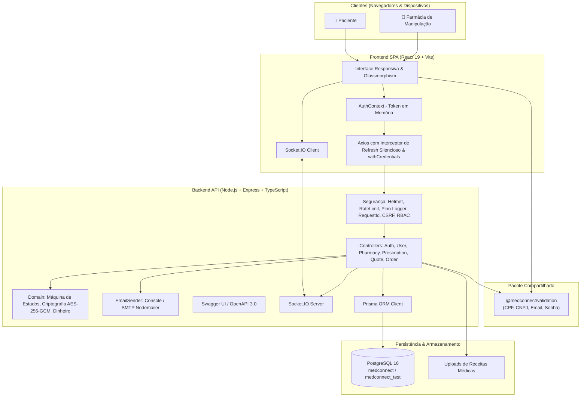
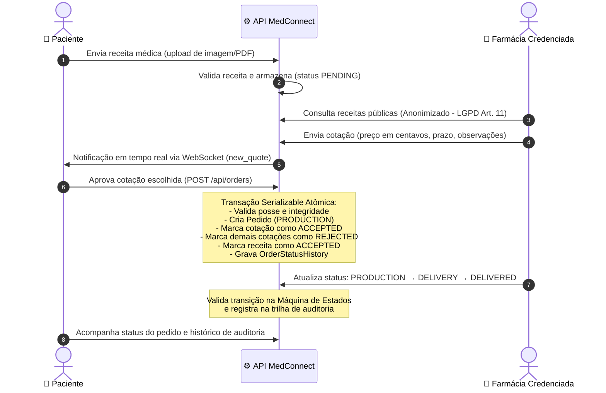

# 💊 MedConnect Application

> Plataforma completa e moderna para cotação, manipulação e acompanhamento de medicamentos entre pacientes e farmácias — desenvolvida com **Monorepo**, **TDD**, **PostgreSQL**, **Prisma**, **OpenAPI/Swagger**, **CI/CD** e padrões rigorosos de segurança e LGPD.


---

## 🚀 Destaques da Solução (Fase 1 — Fundação Técnica)

- **PostgreSQL com Migrations Versionadas**: Schema gerenciado pelo Prisma com migrations versionadas em SQL (`backend/prisma/migrations`), enums nativos, constraints compostas e índices de alta performance.
- **Banco de Testes Isolado**: Testes de integração rodam automaticamente contra um banco dedicado (`medconnect_test`), com limpeza transacional entre suítes e isolamento completo do ambiente de desenvolvimento.
- **Transações Atômicas Serializáveis**: Conversão de cotação em pedido realizada dentro de `prisma.$transaction` com isolamento `Serializable`, garantindo prevenção total de race conditions (aprovações concorrentes rejeitadas com HTTP 409).
- **Máquina de Estados Finita e Auditoria**: Estados de pedido estritamente controlados (`PRODUCTION -> DELIVERY -> DELIVERED` e `PRODUCTION -> CANCELLED`), com gravação atômica da trilha de auditoria na tabela `OrderStatusHistory`.
- **Dinheiro em Centavos (Aritmética Inteira)**: Eliminação de erros de arredondamento de ponto flutuante — cotações e pedidos persistem `priceCents` (`Int`) no banco e convertem na borda da API para string decimal (`"123.45"`).
- **Proteção de Dados Sensíveis e LGPD**: CPF de pacientes com validação matemática oficial (`ehCPFValido`), criptografia em repouso com **AES-256-GCM** via chave `CPF_ENCRYPTION_KEY`, índice cego HMAC-SHA256 (`cpfHash`) para busca eficiente e exibição mascarada (`***.***.***-XX`). Anonimização de receitas para cotação aberta.
- **Autenticação Robusta em Duas Camadas**:
  - Access Token JWT de curta duração (15 min) mantido exclusivamente em memória no frontend (sem `localStorage`).
  - Refresh Token opaco e rotativo, persistido como hash SHA-256 no banco e trafegado via cookie seguro `HttpOnly` com detecção de reuso por família de tokens.
  - Endpoints de refresh, logout, verificação de e-mail e recuperação de senha com proteção contra enumeração de contas e timing attacks via cálculo em tempo constante.
- **Validação, Tratamento Central de Erros e Logs Estruturados**:
  - Validação de `body`, `params` e `query` com Zod em middleware reutilizável.
  - Envelope de erro estrito `{ error: { code, message } }` sem vazamento de stack traces ou detalhes internos.
  - Logs estruturados via Pino com redação automática de dados confidenciais (`authorization`, `cookie`, `password`, `token`, `cpf`, `phone`, `address`) e rastreabilidade por `X-Request-Id`.

---

## 🏛️ Arquitetura do Sistema



---

## 🔄 Fluxo de Negócio (Jornada da Cotação ao Pedido)



---

## 📁 Estrutura do Monorepo

```
MedConnect_Application/
│
├── .github/
│   └── workflows/
│       ├── ci.yml                  # Pipeline CI paralelo (Frontend + Backend)
│       └── deploy-pages.yml        # Deploy contínuo do frontend no GitHub Pages
│
├── MedConnect/                     # Aplicação SPA Frontend (React 19, Vite, Tailwind/CSS)
│   ├── src/
│   │   ├── components/             # Header, BottomNav, Modais, Cards
│   │   ├── context/AuthContext.jsx # Autenticação em memória e renovação de sessão
│   │   ├── pages/
│   │   │   ├── user/               # Home, NewQuote, QuoteOffers, Orders
│   │   │   └── pharmacy/           # Dashboard, Requests, SendQuote, OrderManagement
│   │   ├── services/api.js         # Cliente Axios com interceptor de refresh único
│   │   └── utils/                  # Utilitários e testes
│   └── package.json
│
├── backend/                        # API RESTful (Express, TypeScript, Prisma, Socket.IO)
│   ├── src/
│   │   ├── controllers/            # Lógica de controle com checagens IDOR e RBAC
│   │   ├── domain/                 # Máquina de estados do pedido (orderStateMachine.ts)
│   │   ├── lib/                    # Criptografia de CPF (AES-256-GCM), dinheiro, tokens e logger
│   │   ├── middlewares/            # Validação Zod, tratamento central de erros, rate-limit, CSRF
│   │   ├── services/email/         # Interface EmailSender, ConsoleEmailSender e SmtpEmailSender
│   │   ├── docs/swagger.yaml       # Especificação completa OpenAPI 3.0
│   │   └── routes/                 # Definição de rotas com validação de schemas
│   ├── prisma/
│   │   ├── schema.prisma           # Modelagem relacional PostgreSQL, enums e índices
│   │   ├── seed.ts                 # População com dados sintéticos protegida por ambiente
│   │   └── migrations/             # Migrations versionadas em SQL
│   ├── scripts/                    # Scripts utilitários (db-up.js, ensure-test-db.js)
│   ├── tests/                      # Suítes de testes de integração Jest com isolamento de banco
│   └── package.json
│
├── packages/
│   └── validation/                 # @medconnect/validation compartilhado (ESM + CJS + Types)
│
├── docs/
│   └── decisoes/                   # Architectural Decision Records (ADRs)
│       ├── 001-monorepo-workspaces.md
│       ├── 002-arquitetura-backend-prisma.md
│       ├── 003-validacao-compartilhada-e-seguranca.md
│       ├── 004-gestao-estrita-de-variaveis-de-ambiente-e-remocao-de-fallback-jwt.md
│       ├── 005-isolamento-de-banco-local-scripts-e-procedimento-de-purga.md
│       ├── 006-endurecimento-do-docker-e-isolamento-de-containers.md
│       ├── 007-eliminacao-de-fallback-para-mockdata-no-frontend.md
│       ├── 008-privacidade-lgpd-anonimizacao-de-receitas-e-idor-em-pedidos.md
│       ├── 009-cors-estrito-e-rate-limiting-especifico-para-autenticacao.md
│       ├── 010-postgresql-migrations.md
│       ├── 011-maquina-de-estados-do-pedido.md
│       └── 012-autenticacao-com-refresh-token.md
│
├── docker-compose.yml              # Orquestração do serviço PostgreSQL
├── package.json                    # Raiz do Monorepo (NPM Workspaces)
└── README.md
```

---

## 📖 Decisões Arquiteturais (ADRs)

Todas as principais escolhas técnicas estão documentadas formalmente em [`docs/decisoes/`](./docs/decisoes/):
- **[ADR 001: Adoção de Monorepo com NPM Workspaces](./docs/decisoes/001-monorepo-workspaces.md)**
- **[ADR 002: Arquitetura Backend com Node.js, TypeScript e Prisma ORM](./docs/decisoes/002-arquitetura-backend-prisma.md)**
- **[ADR 003: Validação Compartilhada com TDD e Modelo de Segurança RBAC / IDOR](./docs/decisoes/003-validacao-compartilhada-e-seguranca.md)**
- **[ADR 004: Gestão Estrita de Variáveis de Ambiente e Remoção de Fallback JWT](./docs/decisoes/004-gestao-estrita-de-variaveis-de-ambiente-e-remocao-de-fallback-jwt.md)**
- **[ADR 005: Isolamento de Banco Local, Scripts e Procedimento de Purga](./docs/decisoes/005-isolamento-de-banco-local-scripts-e-procedimento-de-purga.md)**
- **[ADR 006: Endurecimento do Docker e Isolamento de Containers](./docs/decisoes/006-endurecimento-do-docker-e-isolamento-de-containers.md)**
- **[ADR 007: Eliminação de Fallback para MockData no Frontend](./docs/decisoes/007-eliminacao-de-fallback-para-mockdata-no-frontend.md)**
- **[ADR 008: Privacidade LGPD: Anonimização de Receitas e IDOR em Pedidos](./docs/decisoes/008-privacidade-lgpd-anonimizacao-de-receitas-e-idor-em-pedidos.md)**
- **[ADR 009: Restrição Estrita de CORS e Rate Limiting Específico para Autenticação](./docs/decisoes/009-cors-estrito-e-rate-limiting-especifico-para-autenticacao.md)**
- **[ADR 010: Migração para PostgreSQL com Versionamento de Migrations e Isolamento de Testes](./docs/decisoes/010-postgresql-migrations.md)**
- **[ADR 011: Máquina de Estados do Pedido, Trilha de Auditoria e Integridade Transacional](./docs/decisoes/011-maquina-de-estados-do-pedido.md)**
- **[ADR 012: Autenticação Segura com Refresh Token Rotativo em Cookies HttpOnly e Prevenção de Enumeração](./docs/decisoes/012-autenticacao-com-refresh-token.md)**

---

## 🧪 Testes Automatizados

O ecossistema possui **89 testes automatizados** passando em sua totalidade:
- **Frontend SPA**: 33 testes cobrindo autenticação, validações, formulários e renderização de componentes.
- **Backend API**: 56 testes de integração cobrindo transações ACID, máquina de estados, idempotência e unicidade de pedidos, isolamento LGPD/IDOR, expiração e rotação de refresh tokens, detecção de reuso, e segurança de CPF e valores monetários.

```bash
# Executa todos os testes em paralelo no Monorepo
npm run test

# Executa testes isolados por workspace
npm run test:frontend
npm run test:backend
```

---

## ▶️ Como Executar Localmente

### Pré-requisitos
- **Node.js** v20 ou superior
- **NPM** v10 ou superior
- **Docker** e **Docker Compose** (ou porta 5432 liberada para o utilitário integrado)

### Passo a Passo

1. **Clone o repositório e acerte a branch:**
   ```bash
   git clone https://github.com/alexsander020/MedConnect_Application.git
   cd MedConnect_Application
   git checkout fase-1-fundacao
   ```

2. **Instale todas as dependências do Monorepo:**
   ```bash
   npm install --legacy-peer-deps
   ```

3. **Configure as variáveis de ambiente:**
   - No backend: copie o arquivo `.env.example`
   ```bash
   cp backend/.env.example backend/.env
   ```
   > **Nota sobre Criptografia de CPF**: A variável `CPF_ENCRYPTION_KEY` deve conter uma chave hexadecimal de 32 bytes (64 caracteres hex). Para gerar uma chave segura em ambiente de produção:
   > ```bash
   > node -e "console.log(require('crypto').randomBytes(32).toString('hex'))"
   > ```

4. **Inicie o banco PostgreSQL, execute as migrations e popule com dados sintéticos:**
   ```bash
   docker compose up -d postgres && npm run db:migrate && npm run db:seed
   ```
   *(Caso não possua Docker instalado no ambiente local, execute `npm run db:up && npm run db:migrate && npm run db:seed` para ativar a instância gerenciada nativa).*

5. **Inicie o Frontend e o Backend simultaneamente:**
   ```bash
   npm run dev
   ```

6. **Acesse as aplicações:**
   - **Frontend (SPA):** [http://localhost:5173](http://localhost:5173)
   - **API Backend:** [http://localhost:3000](http://localhost:3000)
   - **Documentação Swagger UI:** [http://localhost:3000/api-docs](http://localhost:3000/api-docs)
   - **Prisma Studio (Opcional):** `npm run db:studio` -> [http://localhost:5555](http://localhost:5555)

---

## 👤 Autor

**Alexsander Sudario Abreu**
Estudante de Ciência da Computação — FECAP, São Paulo

[](https://www.linkedin.com/in/alexsander-sudario-0a793524a/)
[](https://github.com/alexsander020)
