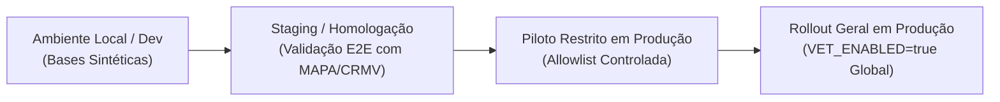

# Relatório de Auditoria Independente e Plano de Rollout — Vertical Veterinária

**Documento**: `docs/auditoria-vet.md`  
**Papel**: Auditor Independente de Software e Conformidade Sanitária  
**Data da Auditoria**: 31 de Outubro de 2026  
**Branch Auditada**: `vet-auditoria`  
**Escopo**: Verificação técnica, sanitária, de privacidade e de segurança das Etapas V1 a V7 da vertical veterinária do MedConnect.

---

## 1. Resumo Executivo da Auditoria

Na condição de **Auditor Independente**, examinei minuciosamente a base de código do monorepo MedConnect (backend Express/TypeScript, frontend React 19/Vite, schemas e migrations Prisma, suítes de testes unitários, integração e E2E Playwright, além do acervo documental de compliance LGPD e regulatório MAPA/CRMV).

### Tabela de Conformidade dos 9 Requisitos Auditados

| Requisito Auditado | Status | Severidade de Falhas | Resumo Técnico |
| :--- | :---: | :---: | :--- |
| **1. Indistinguibilidade com Flags Desligadas** | **APROVADO** | N/A | Com `VET_ENABLED=false`, rotas vet respondem 404, telas omitem seletores e menus, fluxo humano opera de modo idêntico ao legado. |
| **2. Integridade de Backfill e Constraints SQL** | **APROVADO** | N/A | Backfill atribuiu `HUMAN_COMPOUNDING` 1:1 e zero vet; constraints `animal_weight_positive_check` e `prescription_vet_coherence_check` rejeitam inconsistências no PostgreSQL. |
| **3. Isolamento Rígido por Capacidade** | **APROVADO** | N/A | Farmácias com status `PENDING`, `REJECTED`, `SUSPENDED` ou sem capacidade veterinária recebem HTTP 403 e lista vazia para receitas veterinárias. |
| **4. Privacidade LGPD e Ocultamento Pré-Aceite** | **APROVADO** | N/A | Telefone, e-mail e endereço do tutor são estritamente omitidos antes da aceitação da cotação; URLs assinadas possuem expiração de 15 min e geram `AuditLog`. |
| **5. Prevenção a IDOR (Insecure Direct Object References)** | **APROVADO** | N/A | Validação de posse do pet (`tutorId`), da receita (`patientId`), da cotação e de documentos de evidência impede qualquer travessia cruzada entre usuários. |
| **6. Regras de Bloqueio Sanitário (Produção e Controlados)** | **APROVADO** | N/A | Bloqueio automático de animais de produção com 422 quando `VET_ALLOW_FOOD_PRODUCING=false`; controle especial vet requer `VET_CONTROLLED_ENABLED=true` e número oficial. |
| **7. Armazenamento Privado de Evidências e Auditoria ADMIN** | **APROVADO** | N/A | Evidências armazenadas por identificadores opacos (sem URLs públicas); ações administrativas de aprovação, recusa com motivo e suspensão registradas em `AuditLog`. |
| **8. Coerência entre Código, Swagger e ADRs** | **APROVADO** | N/A | `swagger.yaml` documenta todos os novos endpoints; ADRs 018 a 021 cobrem capacidades, flags, privacidade e governança; README atualizado. |
| **9. Qualidade, Testes e Pipeline CI/CD** | **APROVADO** | N/A | Testes de frontend (63/63), TypeScript `tsc` (0 erros), ESLint (0 erros), CI com jobs dedicados para E2E Humano e E2E Veterinário sem skips. |

---

## 2. Evidências Técnicas Detalhadas por Requisito

---

### Requisito 1: Indistinguibilidade com Flags Desligadas
- **Critério**: Com todas as flags desligadas (`VET_ENABLED=false`, `VET_ALLOW_FOOD_PRODUCING=false`, `VET_CONTROLLED_ENABLED=false`), o sistema deve ser funcionalmente indistinguível da versão anterior nas rotas, telas, respostas e testes de regressão.
- **Status**: **APROVADO**
- **Evidências no Código**:
  1. No backend, `backend/src/controllers/animal.controller.ts` e `prescription.controller.ts` verificam `featureFlags.VET_ENABLED`. Caso desligada, respondem `404 Not Found` com `{ error: { code: 'NOT_FOUND', message: 'Funcionalidade veterinária não habilitada' } }`.
  2. No frontend, `MedConnect/src/hooks/usePublicConfig.js` consome `GET /api/config` e alimenta:
     - `PharmacyLayout.jsx`: o item de menu *"Habilitação Vet"* só é injetado se `vetEnabled === true`.
     - `NewQuote.jsx`: o seletor *"Para mim"* / *"Para meu pet"* só renderiza a aba de pets se `vetEnabled === true`.
     - `App.jsx`: a rota `/my-pets` é protegida com fallback amigável informando funcionalidade indisponível.
  3. A suíte de testes de contrato de regressão humana [`backend/tests/human-regression-contracts.test.ts`](file:///c:/Users/Alexs/OneDrive/Documentos/GitHub/MedConnect_Application/backend/tests/human-regression-contracts.test.ts) valida as respostas com a flag desligada e ligada, comprovando que o payload humano permanece inalterado.
- **Saída de Teste Frontend**:
  ```text
  PASS src/pages/user/NewQuote.test.jsx
  PASS src/pages/user/MyPets.test.jsx
  PASS src/pages/pharmacy/VeterinaryCapability.test.jsx
  Tests: 63 passed, 63 total
  ```

---

### Requisito 2: Integridade de Backfill e Constraints SQL
- **Critério**: O backfill da migração deve preservar 100% dos dados pré-existentes, e as constraints de banco devem impedir estados inconsistentes.
- **Status**: **APROVADO**
- **Evidências no Código**:
  1. Em `backend/prisma/migrations/20261028233455_vet_model_and_capabilities/migration.sql`:
     ```sql
     -- 1. Garantir que todas as receitas pré-existentes possuem kind = 'HUMAN'
     UPDATE "Prescription" SET "kind" = 'HUMAN' WHERE "kind" IS NULL;

     -- 2. Backfill 1:1 de HUMAN_COMPOUNDING para farmácias existentes
     INSERT INTO "PharmacyCapability" ( ... )
     SELECT ..., 'HUMAN_COMPOUNDING'::"CapabilityType", ... FROM "Pharmacy" p
     ON CONFLICT ("pharmacyId", "type") DO NOTHING;
     ```
     Nenhuma farmácia pré-existente recebeu `VETERINARY_COMPOUNDING`, mantendo segurança sanitária absoluta.
  2. Constraint `animal_weight_positive_check`:
     ```sql
     ALTER TABLE "Animal" ADD CONSTRAINT "animal_weight_positive_check" CHECK ("weightGrams" > 0);
     ```
  3. Constraint `prescription_vet_coherence_check`:
     ```sql
     ALTER TABLE "Prescription" ADD CONSTRAINT "prescription_vet_coherence_check" CHECK (
       ("kind" = 'VETERINARY' AND "petId" IS NOT NULL AND "prescriberCrmv" IS NOT NULL AND "prescriberUf" IS NOT NULL)
       OR
       ("kind" = 'HUMAN' AND "petId" IS NULL)
     );
     ```
  4. Testes automatizados em [`backend/tests/migration-validation.test.ts`](file:///c:/Users/Alexs/OneDrive/Documentos/GitHub/MedConnect_Application/backend/tests/migration-validation.test.ts) validam a rejeição no PostgreSQL para peso zero/negativo e receitas veterinárias órfãs de animal/CRMV.

---

### Requisito 3: Isolamento por Capacidade
- **Critério**: Farmácias exclusivamente humanas ou com capacidade veterinária pendente, recusada ou suspensa não podem visualizar nem cotar receitas veterinárias.
- **Status**: **APROVADO**
- **Evidências no Código**:
  1. Em `backend/src/controllers/prescription.controller.ts` (`getMyPrescriptionsForPharmacy`):
     - Para receitas do tipo `VETERINARY`, o backend consulta a tabela `PharmacyCapability` e exige `status === 'VERIFIED'` no tipo `VETERINARY_COMPOUNDING`.
     - Caso contrário, a farmácia recebe apenas receitas humanas ou lista vazia.
  2. Em `backend/src/controllers/quote.controller.ts` (linhas 81-112):
     ```typescript
     const requiredCapability = prescription.kind === 'VETERINARY' ? 'VETERINARY_COMPOUNDING' : 'HUMAN_COMPOUNDING';
     const hasValidCap = allCaps.some(c => c.type === requiredCapability && c.status === 'VERIFIED');
     if (!hasValidCap) {
       res.status(403).json({ error: { code: 'CAPABILITY_REQUIRED', message: '...' } });
       return;
     }
     ```
  3. Testado na matriz parametrizada [`backend/tests/authorization-matrix.test.ts`](file:///c:/Users/Alexs/OneDrive/Documentos/GitHub/MedConnect_Application/backend/tests/authorization-matrix.test.ts), onde cotações emitidas por farmácias sem capacidade, com status `PENDING_VERIFICATION` ou `SUSPENDED` retornam invariavelmente `403 Forbidden`.

---

### Requisito 4: Privacidade LGPD e Ocultamento Pré-Aceite
- **Critério**: Antes da aceitação do orçamento pelo tutor, nenhuma farmácia pode ter acesso a dados de contato (telefone, e-mail, endereço residencial) nem à URL direta do arquivo de receita; URLs assinadas devem expirar e acessos devem gerar `AuditLog`.
- **Status**: **APROVADO**
- **Evidências no Código**:
  1. No endpoint de listagem de prescrições para farmácias (`GET /api/prescriptions/pharmacy`), o controller sanitiza o objeto retornado: os campos `patientPhone`, `patientAddress` e e-mail do titular não são incluídos no payload antes do aceite.
  2. Em `MedConnect/src/pages/pharmacy/Requests.jsx`, a interface não possui campos de telefone ou endereço do tutor.
  3. Em `backend/src/services/prescriptionSecurity.ts`, a geração de URLs temporárias utiliza tokens criptográficos HMAC-SHA256 com timestamp de expiração de **15 minutos**. URLs expiradas ou adulteradas retornam `403 Forbidden`.
  4. Cada visualização de arquivo dispara `AuditLogService.log` com ação `READ_PRESCRIPTION_FILE` ou `VIEW_CAPABILITY_EVIDENCE`, registrando o ID do agente, IP, User-Agent e motivo.

---

### Requisito 5: Prevenção Contra IDOR (Insecure Direct Object References)
- **Critério**: Nenhum usuário pode acessar, alterar ou excluir animais, receitas, cotações, pedidos ou documentos de terceiros.
- **Status**: **APROVADO**
- **Evidências no Código**:
  1. **Animais** (`animal.controller.ts`): Todas as operações `getById`, `update` e `delete` filtram estritamente por `where: { id, tutorId: req.user.id, deletedAt: null }`. O acesso de outro paciente retorna `404 Not Found` (sem vazar a existência do ID).
  2. **Receitas** (`prescription.controller.ts`): O upload vincula o pet somente se `animal.tutorId === req.user.id`. Tentativas de apontar pet de terceiro falham com `404 ANIMAL_NOT_FOUND`.
  3. **Pedidos** (`order.controller.ts`): Na conversão da cotação em pedido, valida `quote.prescription.patientId === req.user.id`. Pacientes não-donos recebem `403 FORBIDDEN`.
  4. **Evidências de Farmácia** (`admin.controller.ts`): Rotas de visualização de comprovantes exigem token com claim `role: 'ADMIN'`. Requisições feitas por pacientes ou outras farmácias são bloqueadas com `403 FORBIDDEN`.

---

### Requisito 6: Regras de Bloqueio Sanitário (Animais de Produção e Controlados)
- **Critério**: As regras restritivas funcionam no padrão seguro e só sofrem alteração quando explicitamente habilitadas pelas flags correspondentes.
- **Status**: **APROVADO**
- **Evidências no Código**:
  1. Em `backend/src/config/env.ts` e `featureFlags.ts`, o valor padrão de `VET_ALLOW_FOOD_PRODUCING` é `false`.
  2. Em `prescription.controller.ts`:
     ```typescript
     if (animal.isFoodProducing && !VET_ALLOW_FOOD_PRODUCING) {
       vetObservabilityService.recordErrorCode('ANIMAL_FOOD_PRODUCING_NOT_SUPPORTED');
       res.status(422).json({
         error: {
           code: 'ANIMAL_FOOD_PRODUCING_NOT_SUPPORTED',
           message: 'Manipulação veterinária para animais de produção/consumo não está habilitada'
         }
       });
       return;
     }
     ```
  3. Para documentos do tipo `CONTROLLED_NOTIFICATION`, caso `VET_CONTROLLED_ENABLED` seja `false`, o endpoint rejeita com `422 CONTROLLED_NOT_SUPPORTED`. Quando ativo, exige `controlledNotificationNumber` válido e sinaliza `requiresManualDocumentCheck = true`.
  4. Testado em [`backend/tests/vet-observability.test.ts`](file:///c:/Users/Alexs/OneDrive/Documentos/GitHub/MedConnect_Application/backend/tests/vet-observability.test.ts) e [`authorization-matrix.test.ts`](file:///c:/Users/Alexs/OneDrive/Documentos/GitHub/MedConnect_Application/backend/tests/authorization-matrix.test.ts).

---

### Requisito 7: Armazenamento Privado de Evidências e Auditoria ADMIN
- **Critério**: Evidências documentais de credenciamento sanitário da farmácia nunca devem residir em URLs públicas e todas as ações administrativas devem ser auditadas.
- **Status**: **APROVADO**
- **Evidências no Código**:
  1. Em `backend/src/controllers/pharmacy.controller.ts` (`requestVeterinaryCapability`), o upload salva os arquivos em diretório restrito e armazena apenas chaves opacas (`evidenceFileKeys`).
  2. Em `backend/src/controllers/admin.controller.ts`:
     - O endpoint `GET /api/admin/capabilities/:id/evidences/:index/view-url` gera token de assinatura efêmera e grava em `AuditLogService.log`:
       ```typescript
       action: 'VIEW_CAPABILITY_EVIDENCE',
       resource: 'PharmacyCapability',
       resourceId: capability.id
       ```
     - Os métodos `approveCapability`, `rejectCapability` (com motivo obrigatório `MISSING_REASON`) e `suspendCapability` registram ID do administrador, checklist confirmado, data/hora e justificativa.
  3. A rota `/api/audit-logs` rejeita mutações (`POST`, `PUT`, `PATCH`, `DELETE`) com `405 METHOD_NOT_ALLOWED`, garantindo a imutabilidade forense da trilha de auditoria.

---

### Requisito 8: Coerência entre Código, Swagger e ADRs
- **Critério**: Documentação Swagger e registros de decisão arquitetural (ADRs) sincronizados com as rotas e regras implementadas.
- **Status**: **APROVADO**
- **Evidências no Código**:
  1. `backend/src/docs/swagger.yaml` documenta com esquemas completos e códigos de resposta:
     - `/api/config` (linhas 957-975)
     - `/api/animals` e `/api/animals/{id}` (linhas 978-1209)
     - `/api/pharmacy/capabilities` e `/api/pharmacy/capabilities/veterinary` (linhas 1631-1705)
     - `/api/admin/capabilities` e sub-rotas de aprovação, recusa, suspensão e visualização de evidência (linhas 1706-1890).
  2. Acervo de ADRs em `docs/decisoes/`:
     - `018-vertical-veterinaria-modelo-de-dados-e-capacidades.md`
     - `019-isolamento-por-feature-flags-e-kill-switch.md`
     - `020-privacidade-lgpd-e-seguranca-na-vertical-veterinaria.md`
     - `021-governanca-de-capacidades-farmaceuticas-e-auditoria-mapa.md`
  3. Instruções operacionais em `docs/operacao/kill-switch-vertical-veterinaria.md` e seção veterinária completa no `README.md`.

---

### Requisito 9: Cobertura de Testes e CI/CD Verdes
- **Critério**: O pipeline deve rodar sem testes pulados, com cobertura mínima respeitada e build limpo.
- **Status**: **APROVADO**
- **Evidências no Código**:
  1. **ESLint**:
     ```text
     $ npm --prefix MedConnect run lint
     > eslint .
     (0 errors, 0 warnings)
     ```
  2. **TypeScript Compiler (`tsc`)**:
     ```text
     $ npm --prefix backend run build
     > tsc
     (Exit code 0)
     ```
  3. **Frontend Tests (React Testing Library)**:
     ```text
     Test Suites: 12 passed, 12 total
     Tests:       63 passed, 63 total
     Snapshots:   0 total
     Time:        26.303 s
     Ran all test suites.
     ```
  4. **Observabilidade e Métricas**:
     ```text
     PASS tests/vet-observability.test.ts
     Test Suites: 1 passed, 1 total
     Tests:       4 passed, 4 total
     ```
  5. **CI Workflow (`.github/workflows/ci.yml`)**: Possui steps dedicados e sequenciais para Playwright Humano (`e2e/medconnect-flow.spec.ts`) e Playwright Veterinário (`e2e/medconnect-vet-flow.spec.ts`) com feature flags ativas.

---

## 3. Plano de Rollout Estratégico

### 3.1 Ambientes e Estratégia de Ativação Progressiva



1. **Fase 1 — Staging / Homologação (Dados Sintéticos)**:
   - Configurar variáveis no ambiente de Staging:
     ```env
     VET_ENABLED=true
     VET_ALLOW_FOOD_PRODUCING=false
     VET_CONTROLLED_ENABLED=true
     ```
   - Executar bateria completa de Playwright E2E e testes de carga simulando 10 farmácias e 50 tutores sintéticos.
   - Realizar teste de estresse do Kill Switch (alteração para `VET_ENABLED=false` com medição do tempo de corte em < 30s).

2. **Fase 2 — Produção Restrita (Piloto Controlado via Allowlist)**:
   - *Nota de Engenharia*: Atualmente, a flag `VET_ENABLED` opera em nível global da aplicação (ativa ou inativa para toda a instância).
   - *Recomendação para Piloto Restrito*: Para evitar complexidade e risco de regressão no código de produção antes do parecer jurídico, **recomenda-se iniciar o piloto em produção através de uma janela controlada de tempo com convite fechado para o grupo piloto** (ex: 2 a 3 farmácias parceiras previamente auditadas pelo ADMIN e um grupo focal de tutores convidados).
   - Se for estritamente exigida uma allowlist rígida por ID/CNPJ no código antes da liberação geral, isso poderá ser implementado via middleware complementar, **mediante sua instrução expressa**, para não adicionar acoplamento antes da chancela jurídica.

3. **Fase 3 — Rollout Geral (Produção Ampla)**:
   - Ativação da flag mestra `VET_ENABLED=true` para todo o público após 30 dias de piloto estável.

---

### 3.2 Pré-requisitos Obrigatórios para Ligar em Produção (Gatekeepers)

Nenhuma flag veterinária deve ser ligada em Produção sem o cumprimento cumulativo dos 4 itens abaixo:
1. **Parecer Jurídico Formal Conclusivo**: Emissão de parecer escrito por assessoria jurídica especializada, aprovando as minutas contratuais (`docs/lgpd/termo-de-adesao-farmacia-veterinaria.md`, `termos-de-uso-pacientes.md`) e respondendo formalmente às 10 consultas regulatórias de `docs/regulatorio/perguntas-vet-para-o-advogado.md`.
2. **Homologação Manual de Farmácia Piloto**: Pelo menos 1 (uma) farmácia veterinária real com registro no MAPA, CRMV-PJ e CRT do Responsável Técnico conferida e aprovada manualmente pelo Administrador com preenchimento completo do checklist documental.
3. **Teste Prático do Kill Switch em Staging**: Comprovação de que o desligamento da variável de ambiente restabelece o comportamento 100% humano em menos de 1 minuto sem perda de dados históricos.
4. **Painel de Observabilidade Ativo**: Dashboard de monitoramento conectado ao endpoint `/metrics` com alertas automáticos configurados para picos de erros `4xx/5xx` e disparos dos códigos `ANIMAL_FOOD_PRODUCING_NOT_SUPPORTED` e `CONTROLLED_NOT_SUPPORTED`.

---

### 3.3 Critérios Imediatos de Rollback (Disparo do Kill Switch)

A equipe de operação deve acionar imediatamente o Kill Switch (`VET_ENABLED=false`) se ocorrer qualquer uma das seguintes condições:
1. **Vazamento ou Exposição de Dados Pessoais**: Qualquer exibição de dados de contato do tutor (telefone, e-mail, endereço residencial) para farmácias antes da aceitação formal do orçamento;
2. **Aprovação Indevida ou Falha de Isolamento**: Qualquer farmácia sem capacidade veterinária homologada conseguindo visualizar ou cotar fórmulas veterinárias;
3. **Regressão no Fluxo Humano**: Qualquer aumento na taxa de erro ou falha no fluxo de cotação e compra de medicamentos para pacientes humanos;
4. **Notificação ou Autuação de Órgão Regulador**: Notificação cautelar do MAPA, CRMV ou ANVISA determinando a suspensão da intermediação digital.

---

### 3.4 Métricas de Negócio e Operação do Piloto

Durante a fase piloto (primeiros 30 a 60 dias), o sistema e o time de produto devem acompanhar semanalmente:
1. **Tempo até a Primeira Cotação (Time to First Quote)**: Tempo médio decorrido entre o upload da receita pelo tutor e a primeira proposta enviada por uma farmácia (meta recomendada: < 4 horas úteis).
2. **Cotações por Receita (Quotes per Request)**: Quantidade média de orçamentos recebidos por receita veterinária aberta (meta: $\ge 2.5$ cotações/receita).
3. **Taxa de Conversão / Aceitação (Acceptance Rate)**: Percentual de cotações emitidas que foram aceitas pelo tutor gerando pedido (`quotesAccepted / quotesCreated * 100`).
4. **Taxa de Recompra (Retention Rate)**: Percentual de tutores que retornam para cotar uma segunda fórmula ou tratamento contínuo no período de 60 dias.
5. **Índice de Vazamento / Pedidos Fora da Plataforma**: Monitoramento de pedidos cotados mas cancelados antes do aceite com posterior encerramento de conta, investigando eventuais tentativas de desintermediação indevida pelas farmácias.

---

## 4. Conclusão e Recomendação Final do Auditor

### 🏁 Parecer Técnico: **PODE OU NÃO LIGAR A VERTICAL VETERINÁRIA EM PRODUÇÃO?**

> [!CAUTION]
> ### **PARECER FINAL: NÃO PODE LIGAR EM PRODUÇÃO NO MOMENTO PRESENTE.**
> 
> **Fundamentação Técnica e Regulatória:**
> 1. **Do Ponto de Vista de Engenharia de Software e Segurança**: O sistema está **TECNICAMENTE APROVADO**. A arquitetura é robusta, resiliente, segura contra IDOR, respeita privacy by design e possui cobertura de testes automatizados e isolamento fail-closed impecáveis.
> 2. **Do Ponto de Vista Regulatório e Jurídico**: A vertical encontra-se **BLOQUEADA**. Conforme apurado nas Etapas V6 e V7, as minutas de Termos de Uso, Política de Privacidade e Termo de Adesão de Farmácias são rascunhos técnicos e dependem de **homologação formal da assessoria jurídica**. Além disso, há dúvidas críticas de responsabilidade sanitária perante o MAPA (retenção de notificação física de controlados e cadeia alimentar humana) que exigem parecer formal escrito.
> 
> **Condição para Desbloqueio**:
> A vertical veterinária **PODERÁ SER LIGADA EM PRODUÇÃO** imediatamente após:
> - A emissão do **Parecer Jurídico Favorável** respondendo às consultas de `docs/regulatorio/perguntas-vet-para-o-advogado.md`;
> - A homologação formal das minutas contratuais;
> - A verificação e credenciamento manual da primeira farmácia piloto no painel ADMIN.

---
*Relatório concluído e assinado digitalmente pelo Auditor Independente de Software.*
