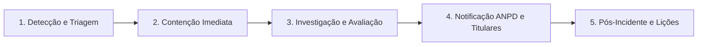

# Plano de Resposta a Incidentes de Segurança da Informação e Violação de Dados Pessoais — MedConnect

> **AVISO IMPORTANTE / DISCLAIMER LEGAL:**
> **RASCUNHO TÉCNICO — REVISÃO JURÍDICA OBRIGATÓRIA.**
> Este documento constitui um modelo operacional técnico de resposta a incidentes de segurança e vazamento de dados pessoais para a plataforma MedConnect. Os autores deste documento **NÃO são advogados**. Todas as diretrizes de comunicação, prazos regulatórios perante a Autoridade Nacional de Proteção de Dados (ANPD) e obrigações de notificação aos titulares de dados estão marcadas como **[PENDENTE DE VALIDAÇÃO JURÍDICA]** e devem ser revisadas e homologadas pela assessoria jurídica e pelo Encarregado de Dados (DPO) da organização.

---

## 1. Objetivo e Escopo

Estabelecer uma metodologia ágil, coordenada e documentada para detectar, conter, investigar, avaliar a gravidade e notificar incidentes de segurança da informação que envolvam o comprometimento de dados pessoais (cadastrais ou de saúde) tratados pela plataforma MedConnect.

### Aplica-se a:
- Acessos não autorizados a cópias de receitas médicas ou prontuários;
- Vazamento de credenciais de acesso de administradores ou farmácias;
- Exfiltração de dados pessoais sensíveis (CPF, receitas, endereços);
- Ataques de ransomware, sequestro de banco de dados ou indisponibilidade prolongada;
- Comprometimento das chaves de criptografia em repouso (`keyId`).

---

## 2. Comitê de Resposta a Incidentes (CRI)

Em caso de confirmação ou suspeita fundamentada de incidente, o Comitê de Resposta a Incidentes é acionado imediatamente:

| Função no Comitê | Responsável Designado | Papel Principal no Incidente |
| :--- | :--- | :--- |
| **Encarregado pelo Tratamento (DPO)** | Nome do DPO / E-mail dpo@medconnect.com.br | Coordenação geral, interlocução com a ANPD, avaliação de impacto aos titulares. |
| **Líder Técnico de Segurança / DevSecOps** | Tech Lead / Engenharia de Software | Investigação forense, isolamento dos sistemas, contenção técnica e erradicação da vulnerabilidade. |
| **Assessoria Jurídica Especializada** | Escritório Jurídico Contratado | Análise de dever regulatório, redação das comunicações formais à ANPD e suporte a medidas judiciais. |
| **Líder de Operações / Comunicação** | Diretor de Operações / Suporte | Gerenciamento de canais de atendimento aos pacientes e farmácias afetadas. |

---

## 3. Fases do Plano de Resposta



---

### Fase 1: Detecção e Triagem Inicial
- **Fontes de Detecção**:
  - Alertas automáticos do sistema (WAF, monitoramento de exceptions, CPU anormal);
  - Consultas anômalas identificadas na tabela `AuditLog` (ex: volume massivo de requisições de leitura de receitas médicas por um único IP);
  - Relatos de usuários via canal de suporte (`suporte@medconnect.com.br`) ou canal de denúncias;
  - Notificações de vulnerabilidades de terceiros ou pesquisadores de segurança.
- **Ação**:
  - Registrar formalmente a hora da notificação e abrir o Registro de Incidente (Ticket de Segurança).
  - Triagem de criticidade preliminar: Baixa (sem exposição de dados), Média (dados cadastrais sem dados de saúde), Alta/Crítica (envolve receitas médicas, senhas ou CPFs em massa).

---

### Fase 2: Contenção Imediata e Preservação de Evidências
- **Contenção Operacional**:
  - Revogação imediata de tokens e sessões ativas do usuário ou atacante envolvido (`RefreshToken.isRevoked = true`);
  - Bloqueio imediato do endereço IP agressor no gateway/firewall;
  - Caso haja suspeita de comprometimento da chave criptográfica, acionar a chave de emergência e rotacionar via `fieldEncryption.ts` (conforme `docs/lgpd/gestao-de-chaves.md`);
  - Se necessário, colocar rotas afetadas temporariamente em modo de manutenção (`HTTP 503`).
- **Preservação de Evidências Forenses**:
  - **NÃO** sobrescrever nem deletar logs. A tabela `AuditLog` já é somente inserção e serve como repositório imutável forense.
  - Exportar snapshots dos logs do servidor web, banco de dados e proxy reverso com cálculo de hash SHA-256 para manter a cadeia de custódia.

---

### Fase 3: Investigação, Avaliação de Risco e Relevância
A equipe técnica, em conjunto com o DPO e o Jurídico, deve responder às perguntas essenciais:
1. **Quais dados foram expostos?** Houve exposição de dados sensíveis de saúde (fórmulas, receitas médicas, prescritores) ou apenas cadastrais?
2. **Quantos titulares foram afetados?**
3. **Qual é o risco aos direitos e liberdades dos titulares?** Há risco de discriminação, extorsão, estelionato, vazamento de condição médica estigmatizante ou dano moral/material relevante?
4. **As medidas técnicas mitigaram o dano?** Os dados estavam cifrados com AES-256-GCM sem que a chave tenha sido comprometida?

---

### Fase 4: Comunicação à ANPD e aos Titulares `[PENDENTE DE VALIDAÇÃO JURÍDICA]`

Conforme o Artigo 48 da LGPD e a Resolução CD/ANPD nº 15/2024:

#### 4.1 Comunicação à ANPD
- **Obrigatoriedade**: Obrigatória sempre que o incidente de segurança envolver dados pessoais que possam acarretar risco ou dano relevante aos titulares.
- **Prazo sugerido a validar**: **3 (três) dias úteis**, contados a partir do conhecimento de que o incidente afetou dados pessoais com potencial lesivo `[PENDENTE DE VALIDAÇÃO JURÍDICA]`.
- **Canal Oficial**: Sistema Eletrônico de Informações (SEI) da ANPD ou formulário oficial de incidentes no portal do governo federal.
- **Conteúdo da Notificação Preliminar**:
  1. Identificação do controlador e do encarregado (DPO);
  2. Data e hora do incidente e da detecção;
  3. Descrição sumária do evento e dados pessoais afetados;
  4. Número total ou estimado de titulares afetados;
  5. Medidas técnicas e de segurança empregadas antes e após o incidente;
  6. Riscos potenciais aos titulares;
  7. Motivo de eventual demora caso a comunicação inicial não seja completa (comunicação complementar em até 20 dias úteis).

#### 4.2 Comunicação aos Titulares Afetados
- **Obrigatoriedade**: Quando houver risco ou dano relevante aos seus direitos e liberdades.
- **Prazo sugerido a validar**: Sem demora injustificada, alinhado com a manifestação da ANPD `[PENDENTE DE VALIDAÇÃO JURÍDICA]`.
- **Meios**: E-mail individual direto cadastrado na conta e aviso em destaque na plataforma web.
- **Linguagem**: Clara, simples, transparente e acessível (sem jargões técnicos herméticos).

---

## 5. Modelos de Comunicação (Templates Rascunho)

### 5.1 Template: Notificação de Incidente ao Titular (Paciente)

```text
ASSUNTO: [COMUNICADO IMPORTANTE DE SEGURANÇA] — MedConnect

Prezado(a) [Nome do Paciente],

A MedConnect preza pela transparência, privacidade e segurança dos seus dados pessoais.

Em conformidade com a Lei Geral de Proteção de Dados (LGPD), comunicamos que identificamos, no dia [Data], um incidente de segurança em nosso ambiente de servidores que afetou potencialmente parte dos dados da sua conta.

O QUE ACONTECEU?
[Descrição clara do incidente sem expor vetores de ataque, ex: "Detectamos um acesso não autorizado que resultou na visualização de arquivos de receitas médicas de um grupo restrito de usuários entre os dias X e Y"].

QUAIS DADOS FORAM AFETADOS?
[Listar dados concretos afetados, ex: "Nome, número de telefone e imagem da receita médica enviada no dia DD/MM/AAAA"].
Informamos expressamente que suas credenciais bancárias e senhas de acesso NÃO foram comprometidas.

QUE MEDIDAS FORAM TOMADAS PELA MEDCONNECT?
1. Nossas equipes de segurança isolaram o ambiente e corrigiram a vulnerabilidade imediatamente.
2. Todas as chaves de acesso foram rotacionadas.
3. A Autoridade Nacional de Proteção de Dados (ANPD) foi devidamente notificada.
4. Reforçamos os controles de auditoria e criptografia em toda a plataforma.

RECOMENDAÇÕES PARA VOCÊ:
- Recomendamos a alteração preventiva da sua senha de acesso na MedConnect.
- Desconfie de contatos telefônicos ou mensagens via WhatsApp em nome de farmácias solicitando pagamentos fora dos canais oficiais da plataforma.

CANAL DE CONTATO DEDICADO:
Nosso Encarregado de Proteção de Dados (DPO) está à disposição para esclarecer qualquer dúvida pelo e-mail: dpo@medconnect.com.br.

Atenciosamente,
Equipe de Segurança e Privacidade da Informação
MedConnect
```

---

## 6. Fase 5: Pós-Incidente e Lições Aprendidas (Post-Mortem)

Em até **5 dias úteis** após a contenção definitiva do incidente:
1. Elaboração do Relatório de Análise de Causa Raiz (RCA - Root Cause Analysis);
2. Identificação de gaps de arquitetura, processos ou treinamento de pessoal;
3. Atualização do Plano de Resposta e dos testes automatizados de segurança no repositório;
4. Apresentação do relatório ao DPO, à Diretoria e ao Jurídico para arquivamento probatório perante eventuais fiscalizações da ANPD.
