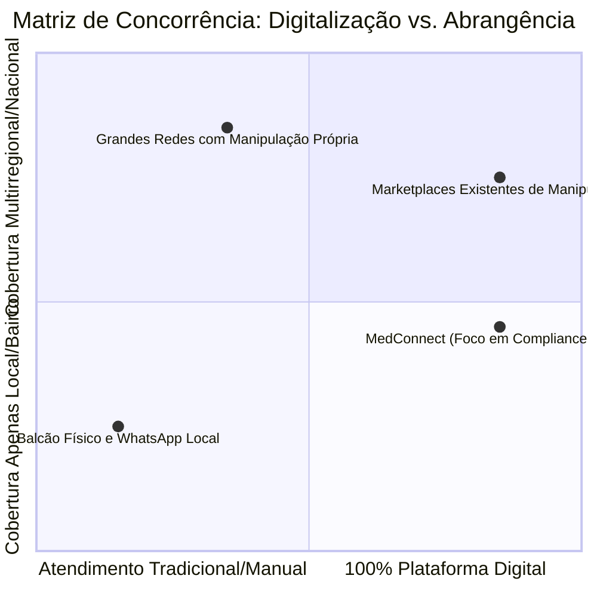

# Esqueleto Estruturado: Análise de Mercado e Concorrência — MedConnect

> **AVISO METODOLÓGICO OBRIGATÓRIO:**
> Conforme diretriz de integridade analítica, **nenhum número ou estimativa de mercado foi preenchido de memória**. Todos os campos quantitativos, faturamentos, volumes de estabelecimentos e participações de mercado estão assinalados como **`[A PREENCHER COM DADO ATUALIZADO — FONTE: NOME_DA_FONTE, ANO]`** para que a equipe de inteligência de mercado insira dados oficiais auditados com citação primária.

---

## 1. Dimensionamento de Mercado (TAM, SAM, SOM)

```text
+---------------------------------------------------------------------------------+
| TAM (Total Addressable Market)                                                  |
| Todo o mercado brasileiro de farmácias magistrais / manipulação                 |
| [A PREENCHER: R$ bilhões/ano] | [FONTE SUGERIDA: ANFARMAG / IQVIA, ANO]         |
+---------------------------------------------------------------------------------+
          |
          v
+---------------------------------------------------------------------------------+
| SAM (Serviceable Addressable Market)                                            |
| Mercado de manipulados nas capitais e regiões metropolitanas com apelo digital  |
| [A PREENCHER: R$ bilhões/ano] | [FONTE SUGERIDA: ANFARMAG / SEBRAE, ANO]        |
+---------------------------------------------------------------------------------+
          |
          v
+---------------------------------------------------------------------------------+
| SOM (Serviceable Obtainable Market)                                             |
| Participação factível da MedConnect no mercado digital em 2 a 3 anos            |
| [A PREENCHER: R$ milhões/ano ou % do SAM] | [PROJEÇÃO INTERNA DA EQUIPE]        |
+---------------------------------------------------------------------------------+
```

### 1.1 Fórmulas e Critérios de Dimensionamento
- **TAM**: Número total de farmácias de manipulação no Brasil $\times$ Faturamento médio anual por estabelecimento.
  - *Número oficial de farmácias magistrais no Brasil*: `[A PREENCHER: ex: ~8.000 a 8.500]`, Fonte: `[ANFARMAG / CFF, ANO: _____]`
  - *Faturamento anual estimado do setor magistral*: `[A PREENCHER: R$ _____ bilhões]`, Fonte: `[ANFARMAG / IQVIA, ANO: _____]`
- **SAM**: Volume de receitas emitidas nas principais regiões metropolitanas de atuação inicial (SP, RJ, MG, Sul).
  - *População-alvo de classes A/B consumidoras de manipulados*: `[A PREENCHER: _____ milhões de pessoas]`, Fonte: `[IBGE / PNAD, ANO: _____]`
  - *Ticket médio nacional por fórmula magistral*: `[A PREENCHER: R$ _____ por fórmula]`, Fonte: `[ANFARMAG / PESQUISA EMPÍRICA, ANO: _____]`
- **SOM**: Meta de penetração no canal online intermediado via plataforma no horizonte de 24 a 36 meses.
  - *Volume estimado de pedidos/mês intermediados no Ano 2*: `[A PREENCHER: _____ pedidos/mês]`
  - *Volume bruto transacionado (GMV projetado)*: `[A PREENCHER: R$ _____ / ano]`

---

## 2. Perfil e Dinâmica do Mercado Farmacêutico Magistral

### 2.1 Segmentação dos Estabelecimentos no Brasil
| Categoria de Estabelecimento | % Estimada do Mercado | Características Operacionais | Aderência à MedConnect |
| :--- | :---: | :--- | :---: |
| **Pequenas Farmácias Independentes (1 loja)** | `[A PREENCHER %]` | Dono acumula função de farmacêutico RT; dependente de WhatsApp manual; alta ociosidade. | **ALTÍSSIMA** (precisam de demanda externa). |
| **Redes Médias Regionais (2 a 5 lojas)** | `[A PREENCHER %]` | Laboratório centralizado; equipe de televendas dedicada; investem em motoboys próprios. | **ALTA** (buscam eficiência de canal digital). |
| **Grandes Redes e Laboratórios Industriais** | `[A PREENCHER %]` | Marcas consolidadas; plataformas web próprias; menor dependência de terceiros. | **MÉDIA/BAIXA** (exigem integração via API direta). |

### 2.2 Especialidades Médicas Líderes em Prescrição de Manipulados
*Indicar com base nos relatórios setoriais mais recentes da ANFARMAG:*
1. **Dermatologia e Cosmiatria**: `[A PREENCHER % de participação nas formulações]`
2. **Nutrologia e Medicina Esportiva**: `[A PREENCHER % de participação]`
3. **Endocrinologia e Metabologia**: `[A PREENCHER % de participação]`
4. **Ortomolecular e Medicina Integrativa**: `[A PREENCHER % de participação]`
5. **Psiquiatria e Neurologia**: `[A PREENCHER % de participação]`
6. **Medicina Veterinária (Manipulação Pet)**: `[A PREENCHER % de participação]`

---

## 3. Mapeamento Competitivo

### 3.1 Categorização dos Concorrentes



---

### 3.2 Matriz Comparativa Detalhada

| Player / Concorrente | Tipo de Solução | Modelo de Monetização Praticado | Prazos de Entrega | Pontos Fortes | Pontos Fracos / Vulnerabilidades |
| :--- | :--- | :--- | :--- | :--- | :--- |
| **Manipulaê** (ou similar nacional) | Marketplace de orçamentos online | `[A PREENCHER COM DADO PÚBLICO: ex: Take rate sobre venda ou taxa de entrega]` | `[A PREENCHER: ex: 2 a 5 dias úteis]` | Marca pioneira conhecida; base de farmácias espalhada pelo Brasil. | Pouca transparência sobre qual farmácia exata manipula; suporte demorado; queixas de entrega no ReclameAqui. |
| **Farmácias APP / Consulta Remédios** | Marketplace focado em alopatia com aba de manipulados | `[A PREENCHER: CPC / Take rate / Mensalidade]` | `[A PREENCHER: Conforme farmácia parceira]` | Tráfego massivo de busca orgânica; escala nacional. | O foco principal é medicamento industrializado de drogaria comum; a experiência de envio de receita magistral é secundária. |
| **WhatsApp Próprio da Farmácia de Bairro** | Atendimento 1 a 1 direto no balcão | Sem comissão externa (custo operacional de atendentes) | `[A PREENCHER: Mesmo dia ou 24-48h]` | Relacionamento pessoal com o cliente; confiança do farmacêutico local. | Processo moroso de digitação manual; o paciente precisa caçar o número de várias farmácias; sem comparabilidade de preços. |
| **MedConnect (Nossa Proposta)** | Plataforma orientada a compliance LGPD, auditoria imutável e SLA garantido | `[A DEFINIR PÓS-PILOTO: Take Rate de 8-10% ou Assinatura fixa]` | 24 a 48h na região piloto | Criptografia AES-256-GCM; consentimento de saúde formal; trilha de auditoria; farmácias com alvará e RT verificados; comparação transparente. | Marca em estágio inicial; necessidade de construir reputação e volume na região piloto. |

---

## 4. Barreiras de Entrada e Fatores Críticos de Sucesso

1. **Barreira Regulatória Sanitária (ANVISA)**:
   - A RDC 67/2007 proíbe postos de captação de receitas; o modelo precisa se posicionar de forma estrita como tecnologia/SaaS de comunicação sem intermediação física de manipulação (ver [`docs/regulatorio/perguntas-para-o-advogado.md`](file:///c:/Users/Alexs/OneDrive/Documentos/GitHub/MedConnect_Application/docs/regulatorio/perguntas-para-o-advogado.md)).
2. **Barreira de Privacidade e Proteção de Dados (LGPD Art. 11)**:
   - O manuseio de receitas médicas exige controles de segurança rígidos (criptografia, auditoria, consentimento específico) que impedem soluções amadoras de baixo custo de competir com segurança jurídica.
3. **Efeito de Rede Local (Liquidez de Marketplace)**:
   - Uma região só tem valor para o paciente se houver pelo menos 3 a 5 farmácias ativas cotando em < 2 horas; e as farmácias só priorizam a plataforma se houver fluxo contínuo de novas receitas.

---

## 5. Diretório de Fontes Primárias para Preenchimento

A equipe deve consultar e citar as seguintes fontes primárias oficiais ao completar os campos:
1. **ANFARMAG** (Associação Nacional de Farmacêuticos Magistrais): Relatórios anuais do Panorama do Mercado Magistral ([anfarmag.org.br](https://anfarmag.org.br)).
2. **Conselho Federal de Farmácia (CFF)**: Dados de estabelecimentos farmacêuticos e farmacêuticos inscritos ([cff.org.br](https://cff.org.br)).
3. **ANVISA** (Agência Nacional de Vigilância Sanitária): Painel de consultas de Autorização de Funcionamento de Empresa (AFE) e alvarás sanitários.
4. **IQVIA Brasil**: Relatórios periódicos do mercado farmacêutico nacional e tendências de consumo de saúde.
5. **SEBRAE**: Estudos setoriais sobre pequenos negócios no setor de farmácias e cosméticos magistrais.
