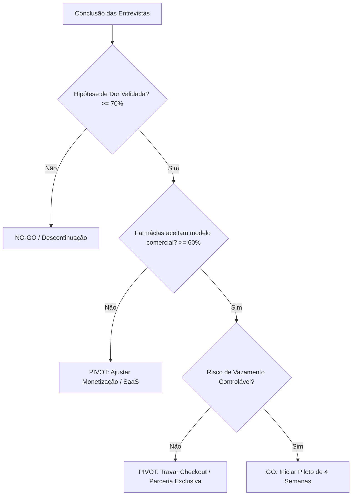

# Modelo de Registro de Entrevistas e Síntese de Evidências — MedConnect

> **FINALIDADE:**
> Este documento padroniza o registro individual de entrevistas qualitativas de validação de negócio (Customer Discovery) e orienta a síntese analítica das evidências coletadas para embasar decisões de produto e precificação.

---

## 1. Ficha de Registro Individual de Entrevista

*Preencha uma ficha para cada entrevista realizada. Armazene os registros brutos em pasta interna da equipe.*

### 1.1 Ficha do Paciente
```markdown
### Entrevista Paciente #[ID]
- **Data/Hora**: [DD/MM/AAAA - HH:MM]
- **Entrevistador**: [Nome do membro do time]
- **Perfil do Paciente**: [Idade aproximada, Cidade/Bairro, Profissão]
- **Frequência de Uso**: [Mensal / Trimestral / Esporádico]
- **Especialidades Médicas / Tipos de Fórmula**: [Dermatologia, Psiquiatria, Nutrologia, etc.]
- **Ticket Médio Declarado**: [R$ X por fórmula]

#### Respostas e Evidências Chave:
1. **Comportamento de Cotação**:
   - Quantas farmácias cota atualmente? [ ] 1 apenas  [ ] 2 a 3  [ ] 4 ou mais
   - Meio utilizado: [ ] WhatsApp  [ ] Balcão físico  [ ] Site próprio
   - Tempo médio de espera: [Horas / Dias]
   - Maior frustração relatada: [Descrever dor]

2. **Sensibilidade a Preço vs. Prazo**:
   - Variação de preço percebida entre farmácias: [R$ X ou % estimada]
   - Fator decisivo de compra: [ ] Preço  [ ] Prazo  [ ] Indicação do médico  [ ] Localização
   - Reação à farmácia diferente da recomendada pelo médico: [Aceita se for certificada / Recusa]

3. **Risco de Desintermediação (Vazamento)**:
   - Primeiro impulso ao ver o nome da farmácia cotante: [ ] Fechar no app  [ ] Chamar no WhatsApp
   - O que o faria pagar no app: [Garantia de reembolso, frete grátis, parcelamento, etc.]
   - Disposição a pagar taxa de conveniência: [ ] Sim (R$ X)  [ ] Não

4. **Citações Literais (Verbatim)**:
   - *"Citação 1 mais impactante dita pelo paciente..."*
   - *"Citação 2 sobre a maior dor..."*

5. **Classificação do Entrevistado**:
   - [ ] Early Adopter (dor intensa, busca ativamente solução, quer testar piloto)
   - [ ] Usuário Comum (reconhece o problema, mas tem baixa urgência)
   - [ ] Resistente (satisfeito com o status quo, não vê motivo para mudar)
```

---

### 1.2 Ficha da Farmácia de Manipulação
```markdown
### Entrevista Farmácia #[ID]
- **Data/Hora**: [DD/MM/AAAA - HH:MM]
- **Entrevistador**: [Nome do membro do time]
- **Nome da Farmácia**: [Razão Social / Nome Fantasia]
- **Entrevistado / Cargo**: [Proprietário / Farmacêutico RT / Gerente Comercial]
- **Localização**: [Bairro / Cidade / UF]
- **Porte**: [ ] 1 loja  [ ] 2 a 5 lojas  [ ] Grande rede
- **Volume Diário de Receitas**: [Ex: 30 a 50 receitas/dia]
- **Sistema Magistral (ERP)**: [FórmulaCerta, Fagron, MasterSiga, etc.]

#### Respostas e Evidências Chave:
1. **Gargalo Operacional no WhatsApp**:
   - Taxa de conversão declarada: [X%]
   - Tempo médio da equipe para orçar 1 receita: [X minutos]
   - Nível de ociosidade do laboratório: [Baixa / Média / Alta]

2. **Aceitação de Cotar por Plataforma**:
   - Disposição a responder cotações digitais em até 4h: [ ] Alta  [ ] Média  [ ] Baixa
   - Maior objeção operacional: [Tempo de redigitação, receio de guerra de preços, etc.]

3. **Validação do Modelo de Monetização**:
   - Modelo A (Custo por Lead, ex: R$ 5/receita): [Aceita / Rejeita / Comentário]
   - Modelo B (Take Rate por Venda, ex: 10%): [Aceita / Rejeita / Comentário]
   - Modelo C (Assinatura Mensal, ex: R$ 250/mês): [Aceita / Rejeita / Comentário]
   - Modelo Preferido da Farmácia: [Lead / Venda / Assinatura]
   - Faixa de preço / comissão aceitável declarada: [R$ ou %]

4. **Risco de Desintermediação (Vazamento)**:
   - Tentaria migrar o cliente para WhatsApp próprio na 2ª compra? [Sim / Não / Depende]
   - O que manteria a farmácia dentro da plataforma na recompra? [Menor comissão na recompra, automação de renovação, penalidade de perda de novos leads]

5. **Citações Literais (Verbatim)**:
   - *"Citação 1 da farmácia sobre a dor de vendas..."*
   - *"Citação 2 sobre a comissão/preço..."*

6. **Interesse em Participar do Piloto**:
   - [ ] Sim, com alta prioridade
   - [ ] Talvez, precisa de mais detalhes contratuais
   - [ ] Não tem interesse no momento
```

---

## 2. Matriz Consolidada de Síntese de Padrões

*Esta tabela deve ser consolidada pelo time após atingir 10 a 15 entrevistas de pacientes e 8 a 10 entrevistas de farmácias.*

### 2.1 Padrões Identificados: Pacientes

| Hipótese | % Validação (Sim / Total) | Padrão Comportamental Observado | Citação Mais Frequente (Verbatim) | Impacto no Produto |
| :--- | :---: | :--- | :--- | :--- |
| **Compara preço e prazo** | `[A PREENCHER: ex: 80%]` | Pacientes que tomam mais de 2 fórmulas sempre pesquisam em ao menos 2 farmácias. | *"Dá muita diferença de uma para outra, às vezes mais de 50 reais."* | Reforçar comparação clara lado a lado na tela de orçamentos. |
| **Aceita comprar fora do médico** | `[A PREENCHER: ex: 65%]` | Aceitam se a farmácia tiver alvará verificado e boas avaliações. | *"Se o médico não insistir muito em uma, eu prefiro economizar."* | Exibir selo de farmácia verificada e CRF do RT em destaque. |
| **Risco de Desintermediação** | `[A PREENCHER: ex: 45%]` | Alta tentação de chamar no WhatsApp se o app não tiver checkout fluido. | *"Se demorar para aprovar no site, eu prefiro mandar no WhatsApp da farmácia direto."* | Checkout com 1 clique (Pix/Cartão) e confirmação imediata. |

### 2.2 Padrões Identificados: Farmácias

| Hipótese | % Validação (Sim / Total) | Padrão Comportamental Observado | Citação Mais Frequente (Verbatim) | Impacto no Modelo de Negócio |
| :--- | :---: | :--- | :--- | :--- |
| **Aceita cotar por app** | `[A PREENCHER: ex: 75%]` | Desde que o processo seja ágil e não exija preencher 20 campos. | *"A gente quer receita nova, mas não posso colocar uma pessoa só pra responder app se não vender."* | Tela de cotação simplificada: apenas preço, dias de entrega e notas. |
| **Modelo Comercial Preferido** | `[A PREENCHER]` | Rejeição a lead pago; preferência por % na venda ou SaaS após prova de volume. | *"Cobrar por receita que não compra é injusto; prefiro dar 10% do que foi pago."* | Iniciar piloto com modelo de Success Fee (Take Rate) ou isenção promocional. |
| **Desintermediação de Recompra** | `[A PREENCHER: ex: 60%]` | Tendência a enviar panfleto na caixa física do produto. | *"O cliente conheceu a gente, é natural que a gente queira manter ele."* | Criar taxa decrescente de recompra (ex: 5%) e lembrete automático de renovação. |

---

## 3. Matriz de Critérios de Decisão (Go / Pivot / No-Go)

Após a rodada de entrevistas, o time executivo deve aplicar a seguinte régua objetiva para tomada de decisão:



1. **Critério GO (Avançar para o Piloto)**:
   - Pelo menos **70% dos pacientes** relatam que comparar preços no WhatsApp é demorado e gostariam de comparar em 1 só lugar.
   - Pelo menos **60% das farmácias** aceitam enviar orçamentos na plataforma e concordam com comissão sobre a venda (entre 8% e 12%) ou mensalidade após piloto.
   - Pelo menos **4 farmácias** assinam a carta de intenção para participar do piloto de 4 semanas.
2. **Critério PIVOT (Ajustar Modelo)**:
   - Se farmácias rejeitarem comissão percentual, pivotar para modelo de mensalidade fixa baixa (SaaS) ou parceria de software de fidelização de clientes.
   - Se o risco de vazamento for superior a 70%, o produto deve ocultar o nome da farmácia antes do aceite da cotação ("Farmácia Verificada - Zona Sul") para evitar desvio antes do fechamento.
3. **Critério NO-GO (Interromper Projeto)**:
   - Menos de 40% dos pacientes aceitam comprar de outra farmácia além da indicada pelo médico.
   - Farmácias se recusam terminantemente a responder orçamentos fora do WhatsApp próprio por falta de mão de obra.
